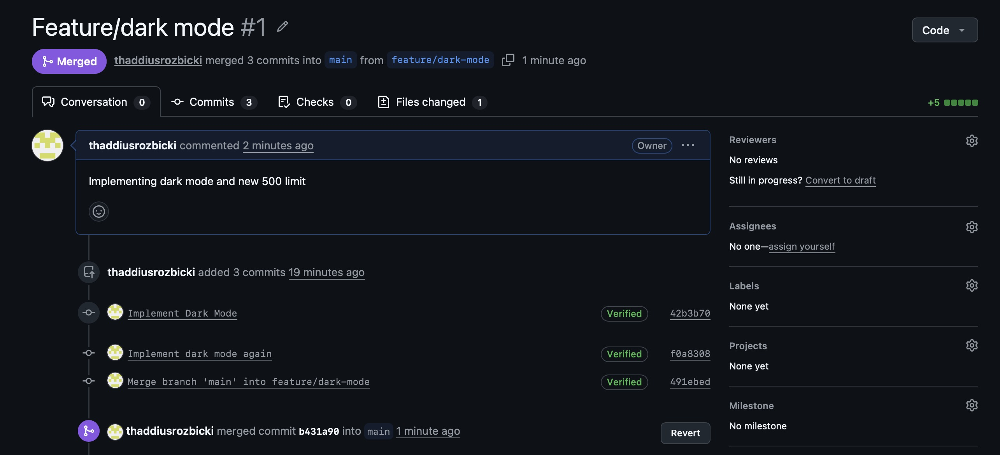

I think Git will be useful in my future career anytime I'm collaborating with others on a software project, since it lets everyone see who changed what and when. I'm planning to go into accounting and finance, but with my data science minor I'm fairly sure Python will come up at some point, and Git will help keep both me and my team organized. It's also useful for personal projects, especially ones I set aside for a year and come back to, because the commit history shows what each piece of code does and what I was thinking when I wrote it.

